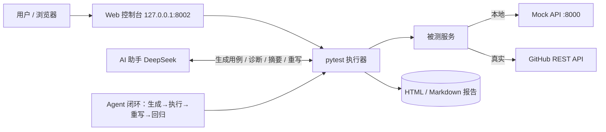

# AI 自动化测试平台（auto-test-platform）

本地 AI 智能体自动化测试平台：pytest 做自动化底座，接入 DeepSeek 大模型形成 **"自然语言生成用例 → 失败自动诊断 → AI 自修复回归"** 的智能体闭环，并配套一个本地 Web 控制台一键操作；另含 GitHub 真实 API 演示场景。

> 从 0 到 1 的自研个人作品：**零服务端依赖、纯本地可跑、AI 按量付费成本极低**，覆盖自动化测试的完整链路（用例设计、执行、诊断、修复、报告、可视化）。

## 核心能力

| 阶段 | 能力 | 说明 |
|---|---|---|
| 1 | pytest 自动化底座 | 统一请求封装（`api/client.py`）、配置管理、日志、HTML 报告；本地 Mock 服务（纯标准库） |
| 2 | AI 测试助手（DeepSeek） | 自然语言一键生成用例并执行；失败根因诊断；全量测试中文摘要（含风险提示） |
| 3 | Agent 闭环 | 生成 → 执行 → 失败则 AI 读取代码与输出、重写文件 → 回归，最多 N 轮自动迭代 |
| 4 | Web 控制台 | 浏览器一键：启动/停止被测服务、跑测试、AI 生成/诊断/摘要/闭环、浏览全部报告 |
| + | 真实 API 演示 | 直接测 GitHub REST API（真实外网、无需 key），含"稳定断言"与网络容错示例 |

## 架构



## 快速体验

```bash
# 1. 安装依赖（首次）
python -m venv .venv
.venv\Scripts\python -m pip install -r requirements.txt

# 2. 启动被测服务（本地 Mock，端口 8000）
.venv\Scripts\python mock_api.py

# 3. 一键跑测试（本地 13 条 + GitHub 真实 API 4 条）
.venv\Scripts\python -m pytest
#   报告自动生成：reports\report.html

# 4. 打开 Web 控制台（端口 8002，浏览器操作）
.venv\Scripts\python web\app.py
#   或双击 scripts\start_web.bat
```

## AI 助手三命令

```bash
# 自然语言生成用例并自动执行
.venv\Scripts\python scripts\ai_tool.py generate "写3个用例：健康检查、用户列表、echo回显"

# 诊断测试失败根因（DeepSeek 分析代码与输出）
.venv\Scripts\python scripts\ai_tool.py diagnose tests\generated\test_auto_xxx.py

# 全量测试的中文摘要
.venv\Scripts\python scripts\ai_tool.py summary
```

需要环境变量 `DEEPSEEK_API_KEY`（DeepSeek 平台注册后按量付费，成本极低）。

生成的用例按正规格式输出：代码 docstring 含规范用例元素（用例编号 / 用例标题 / 前置条件 / 测试步骤 / 预期结果），并同步生成 `reports/testcases_*.md` 用例说明文档——可在 Web 控制台「报告中心」直接查看，也可作为交付给业务方的用例文档。

## Agent 闭环

```bash
# 自然语言 → 生成用例 → 执行 → 失败则 AI 重写 → 回归（默认最多 3 轮）
.venv\Scripts\python scripts\ai_tool.py agent "写3个用例：健康检查、用户列表、echo回显"

# 对现有测试文件做闭环修复；可指定轮数
.venv\Scripts\python scripts\ai_tool.py agent tests\generated\test_xxx.py 5
```

每轮决策写入 `reports\agent_*.md`，可完整回看 AI 的修复过程。

## 真实 API 演示（GitHub）

`tests\test_github_api.py` 直接测 GitHub REST API（免费、无需 key，无 token 限 60 次/小时）：

- 覆盖：rate_limit / 仓库关键字段 / 用户资料 / 404 契约
- **稳定断言**：对易变数据（star 数等）只断言结构与类型，不做死值——真实接口测试的正确写法
- **网络容错**：外网不可达自动 skip，离线/CI 环境不报红
- `.env` 配 `GITHUB_TOKEN` 可把限额提升到 5000 次/小时

## 目录结构

```
auto-test-platform/
├── api/            # API 客户端封装（统一请求、默认 headers、日志、超时）
├── config/         # 配置（settings.py 读取 .env，支持 BASE_URL / GITHUB_TOKEN 等）
├── tests/          # 用例（conftest.py 提供 api_client / github_client fixture）
│   └── generated/  # AI 生成的用例
├── ai/             # DeepSeek 客户端 / 用例生成 / 失败诊断 / 报告摘要 / Agent 闭环
├── web/            # Web 控制台后端 + 前端
├── scripts/        # ai_tool.py 入口、一键启动脚本
├── utils/          # 日志工具
├── mock_api.py     # 本地 Mock 被测服务（纯标准库）
├── pytest.ini      # pytest 配置（HTML 报告输出）
└── requirements.txt
```

## 验证结果

- 本地 Mock 用例 13 条全过 + GitHub 真实 API 用例 4 条全过 = **17 passed**
- Agent 闭环实战：故意注入 2 处断言错误 → 第 1 轮失败、AI 重写测试文件、第 2 轮全过（全程可回看 `reports/agent_*.md`）
- AI 生成用例实战：首次 AI 猜错接口响应结构 → 诊断定位根因 → 修正生成器提示词 → 重新生成 3 条全过

## 技术栈与成本

Python 3.13 · pytest · requests · python-dotenv · pytest-html · DeepSeek API（按量付费）

项目零基础设施依赖：本地即可跑通全链路；AI 调用只在需要生成/诊断/摘要时产生，费用按 token 计，个人学习使用几乎为零成本。

## 路线图

- 定时调度：每日自动回归 + AI 摘要推送
- 报告中心增强：历史趋势、失败率统计
- 性能数据自动分析（可对接 CSV 导出数据生成结构化报告）

## 版本管理

- 本地 Git 仓库（main 分支），`.venv / reports / logs / .env / web/mock.pid` 已忽略
- 提交署名：3045099065 / 3045099065@qq.com
